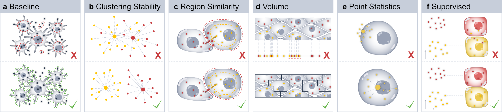

.. SegTraQ documentation master file, created by
   sphinx-quickstart on Mon Aug  4 17:10:41 2025.
   You can adapt this file completely to your liking, but it should at least
   contain the root `toctree` directive.

SegTraQ
=======

SegTraQ (Segmentation and Transcript Assignment Quality Control) is a Python toolkit for quantitative and visual quality assessment of segmentation and transcript assignment in spatial omics data.

⚠️ Note: SegTraQ is under active development. Features, interfaces, and functionality may change in upcoming releases.

.. toctree::
   :maxdepth: 1
   :caption: Getting started

   notebooks/quickstart
   notebooks/io
   notebooks/io_extended

.. toctree::
   :maxdepth: 1
   :caption: Applications

   notebooks/segmentation_comparison
   notebooks/multi_sample
   notebooks/visium_hd

.. toctree::
   :maxdepth: 1
   :caption: Modules

   notebooks/baseline
   notebooks/region_similarity
   notebooks/supervised
   notebooks/clustering_stability
   notebooks/volume
   notebooks/point_statistics

.. toctree::
   :maxdepth: 1
   :caption: API reference

   modules/baseline
   modules/clustering_stability
   modules/region_similarity
   modules/supervised
   modules/point_statistics
   modules/volume
   modules/plotting
   modules/segtraq_class
   modules/utils
   modules/datasets
